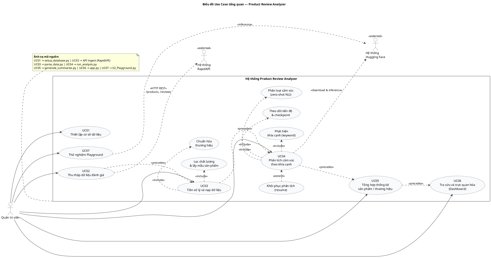
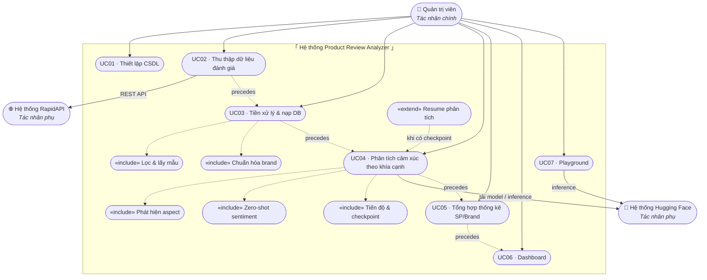
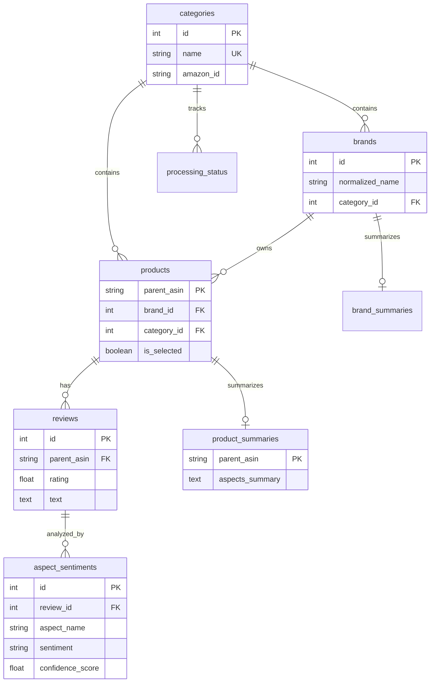
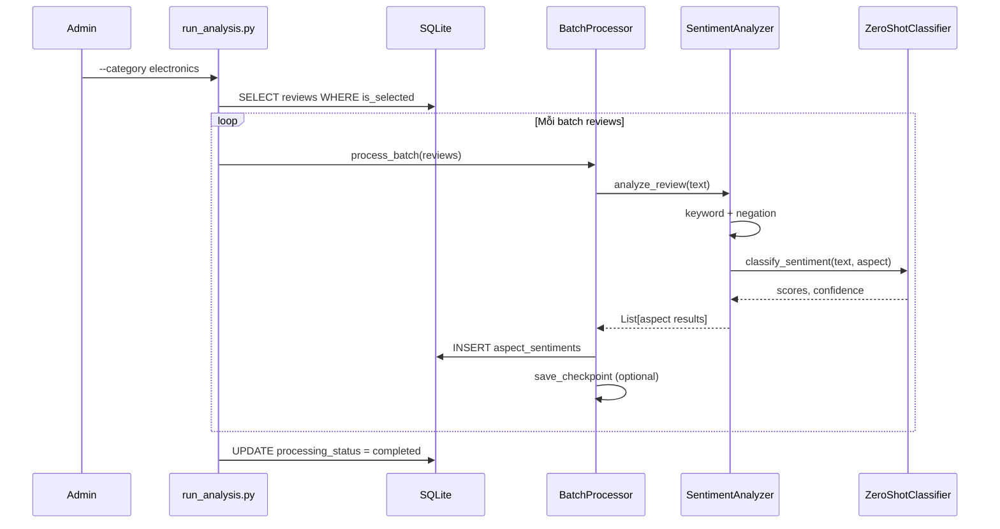
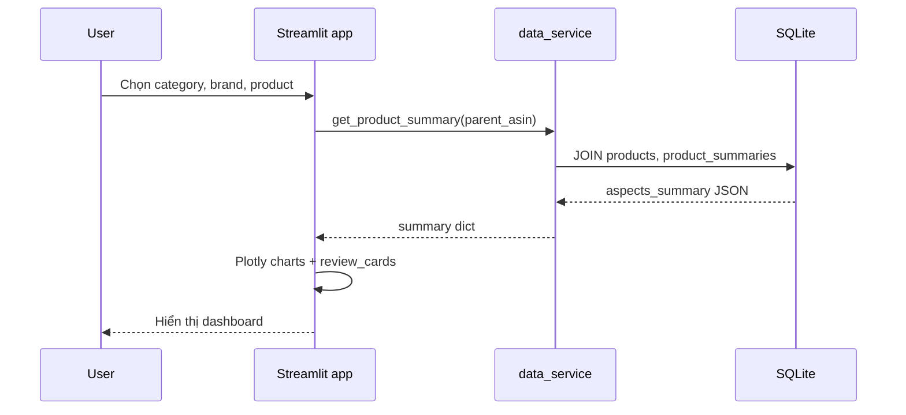

# BÁO CÁO ĐỒ ÁN TỐT NGHIỆP

## Hệ thống phân tích cảm xúc đánh giá sản phẩm theo khía cạnh (Aspect-Based Product Review Analyzer)

**Sinh viên thực hiện:** _[Điền họ tên, MSSV]_  
**Giảng viên hướng dẫn:** _[Điền tên GVHD]_  
**Khoa / Bộ môn:** _[Điền]_  
**Thời gian:** 2025–2026  

---

## MỤC LỤC

1. [Chương 1: Cơ sở lý thuyết và tổng quan công nghệ](#chương-1-cơ-sở-lý-thuyết-và-tổng-quan-công-nghệ)
2. [Chương 2: Phân tích và thiết kế hệ thống](#chương-2-phân-tích-và-thiết-kế-hệ-thống)
3. [Chương 3: Cài đặt và thử nghiệm](#chương-3-cài-đặt-và-thử-nghiệm)
4. [Kết luận và hướng phát triển](#kết-luận-và-hướng-phát-triển)
5. [Tài liệu tham khảo](#tài-liệu-tham-khảo)

---

# CHƯƠNG 1: CƠ SỞ LÝ THUYẾT VÀ TỔNG QUAN CÔNG NGHỆ

**Mục đích:** Chứng minh nền tảng kiến thức và công cụ được nắm vững trước khi triển khai hệ thống.

## 1.1. Tổng quan về bài toán

### 1.1.1. Bối cảnh nghiệp vụ

Thương mại điện tử tạo ra lượng lớn **đánh giá sản phẩm (product reviews)** từ người mua. Mỗi review thường đề cập nhiều **khía cạnh (aspects)** — pin, màn hình, giá, chất lượng — với **cảm xúc (sentiment)** khác nhau trong cùng một câu. Ví dụ: *"Battery lasts all day but the screen is dim"* chứa ý kiến tích cực về pin và tiêu cực về màn hình.

Bài toán của đồ án: **tự động trích xuất sentiment theo từng aspect** từ review tiếng Anh, tổng hợp cấp **sản phẩm** và **thương hiệu**, phục vụ ra quyết định kinh doanh (R&D, marketing, chăm sóc khách hàng).

### 1.1.2. Các khái niệm nghiệp vụ lõi

| Khái niệm | Định nghĩa | Ví dụ trong hệ thống |
|-----------|------------|----------------------|
| **Review** | Văn bản đánh giá kèm rating, metadata | Bảng `reviews` |
| **Product (ASIN)** | Sản phẩm định danh `parent_asin` | Bảng `products` |
| **Brand** | Thương hiệu chuẩn hóa từ metadata | Bảng `brands` |
| **Category** | Ngành hàng (Electronics, Beauty…) | `config/categories/*.yaml` |
| **Aspect** | Khía cạnh sản phẩm cần phân tích | `battery`, `screen`, `value`… |
| **Aspect tier** | Mức ưu tiên phân tích/hiển thị | Tier 1 (core), 2 (common), 3 (optional) |
| **Sentiment** | Nhãn cảm xúc | `positive`, `negative`, `neutral` |
| **Confidence** | Độ tin cậy dự đoán ML | `confidence_score` trong `aspect_sentiments` |
| **Product summary** | Tổng hợp thống kê + review tiêu biểu | Bảng `product_summaries` |

### 1.1.3. Phạm vi đồ án

- **Đầu vào:** Review sản phẩm tiếng Anh, lấy qua **REST API (RapidAPI)** theo category và bộ lọc sản phẩm.
- **Xử lý:** Tiền xử lý → lưu SQLite → phân tích hybrid (keyword + zero-shot NLI).
- **Đầu ra:** Dashboard Streamlit (biểu đồ aspect, danh sách review có nhãn, trang Playground thử nghiệm).

---

## 1.2. Cơ sở lý thuyết

### 1.2.1. Phân tích cảm xúc theo khía cạnh (Aspect-Based Sentiment Analysis — ABSA)

ABSA mở rộng sentiment analysis truyền thống (một nhãn cho cả câu) thành **(aspect, sentiment)** cho từng ý trong review. Hai hướng phổ biến:

1. **Supervised:** Huấn luyện mô hình trên tập gán nhãn (SemEval, Amazon aspect datasets) — độ chính xác cao nhưng tốn chi phí gán nhãn.
2. **Zero-shot / weakly supervised:** Dùng mô hình ngôn ngữ lớn đã pre-train, không cần huấn luyện riêng cho đồ án — phù hợp prototype và đa category.

Đồ án chọn **zero-shot NLI** kết hợp **keyword theo domain** (YAML) để giảm nhiễu và chi phí inference.

### 1.2.2. Zero-shot classification và Natural Language Inference (NLI)

Mô hình **MNLI** (Multi-Genre Natural Language Inference) học quan hệ: *premise* — *hypothesis* → `entailment` / `contradiction` / `neutral`.

**Zero-shot classification** tái sử dụng NLI bằng cách:

- **Premise:** Câu review.
- **Hypothesis:** Mẫu câu như `"positive about battery"`, `"negative about battery"`.
- **Nhãn:** Lớp có xác suất entailment cao nhất.

Hệ thống dùng **DistilBART-MNLI** (`valhalla/distilbart-mnli-12-3`) — phiên bản distilled của BART-MNLI, cân bằng tốc độ và độ chính xác trên GPU/CPU.

### 1.2.3. Kiến trúc phần mềm áp dụng

Hệ thống tổ chức theo **layered / modular architecture** (không phải microservices):

```
Presentation (Streamlit UI)
        ↓
Application / Services (data_service, scripts pipeline)
        ↓
Domain (SentimentAnalyzer, AspectManager, BrandExtractor)
        ↓
Infrastructure (SQLite, Hugging Face Transformers, RapidAPI client)
```

**Cấu hình tách biệt mã nguồn:** `config/app.yaml`, `config/models.yaml`, `config/categories/electronics.yaml` — nguyên tắc *configuration over hard-coding*.

### 1.2.4. Các kỹ thuật bổ trợ trong pipeline AI

| Kỹ thuật | Mục đích | Module |
|----------|----------|--------|
| Keyword pre-filter | Chỉ phân tích aspect có bằng chứng từ vựng | `AspectManager`, `SentimentAnalyzer` |
| Negation handling | Xử lý "not good", "but however" | `negation_handler.py` |
| Confidence gating | Lọc dự đoán yếu theo tier | `SentimentAnalyzer` |
| Rating validator | So khớp sentiment vs rating sao | `validators.py` |
| Batch + checkpoint | Xử lý hàng loạt, resume khi lỗi | `batch_processor.py` |
| Cache | Tránh phân tích trùng review | `analysis_cache`, in-memory cache |

---

## 1.3. Công nghệ và công cụ sử dụng

### 1.3.1. Ngôn ngữ và framework

| Thành phần | Công nghệ | Vai trò |
|------------|-----------|---------|
| **Backend / Pipeline** | Python 3.9+ | Toàn bộ ETL, AI, CLI |
| **Frontend / Dashboard** | Streamlit 1.28+ | Giao diện web tương tác |
| **Trực quan hóa** | Plotly 5.17+ | Biểu đồ aspect, so sánh sentiment |
| **ML / NLP** | PyTorch 2.0+, Transformers 4.35+ | Zero-shot inference |
| **Dữ liệu** | Pandas, NumPy | Xử lý batch, thống kê |
| **ORM** | SQLAlchemy 2.0+ | Truy cập SQLite |
| **Cấu hình** | PyYAML, python-dotenv | Category/model/env |

### 1.3.2. Hệ quản trị cơ sở dữ liệu

- **SQLite 3** — file `data/processed/reviews.db`
- **Lý do:** Đồ án/demo, triển khai đơn máy, không cần server DB riêng; WAL mode hỗ trợ đọc/ghi song song nhẹ.
- **Mở rộng tương lai:** `docker-compose.yml` đã comment sẵn PostgreSQL cho production.

### 1.3.3. Môi trường và công cụ triển khai

| Công cụ | Mục đích |
|---------|----------|
| **Docker / Docker Compose** | Đóng gói UI Streamlit (port 8501) |
| **venv / pip** | Môi trường phát triển chính (GPU analysis chạy native) |
| **pytest** | Kiểm thử unit + golden cases |
| **Git, Cursor IDE** | Quản lý mã nguồn, AI hỗ trợ refactor/debug |
| **Hugging Face Hub** | Tải và cache pre-trained model |

### 1.3.4. Lý do lựa chọn công nghệ

| Lựa chọn | Thay thế có thể | Lý do chọn |
|----------|-----------------|------------|
| **Zero-shot (DistilBART-MNLI)** | Fine-tune BERT/RoBERTa | Không cần tập gán nhãn lớn; mở rộng category bằng YAML |
| **SQLite** | PostgreSQL, MongoDB | Đơn giản, portable, đủ cho hàng triệu dòng review demo |
| **Streamlit** | React + FastAPI | Tốc độ phát triển UI cao, tích hợp Python/Plotly trực tiếp |
| **RapidAPI (REST)** | Scraping, file JSONL tĩnh | Chuẩn hóa ingestion, rate limit rõ ràng, dễ mô tả kiến trúc API-first |
| **Hybrid keyword + ML** | Chỉ ML | Giảm hallucination aspect, giảm 40–60% số lần gọi model |

---

# CHƯƠNG 2: PHÂN TÍCH VÀ THIẾT KẾ HỆ THỐNG

**Mục đích:** Thể hiện tư duy phân tích yêu cầu và thiết kế kiến trúc trước khi hiện thực.

## 2.1. Phân tích yêu cầu

### 2.1.1. Yêu cầu chức năng (Functional Requirements)

| ID | Yêu cầu | Mô tả |
|----|---------|-------|
| FR-01 | Thu thập dữ liệu | Gọi RapidAPI lấy metadata sản phẩm và review theo category |
| FR-02 | Tiền xử lý & nạp DB | Lọc chất lượng text, sampling sản phẩm, chuẩn hóa brand |
| FR-03 | Phân tích aspect-sentiment | Gán (aspect, sentiment, confidence) cho từng review |
| FR-04 | Tổng hợp | Tạo `product_summaries`, `brand_summaries` |
| FR-05 | Dashboard | Chọn category → brand → product, xem biểu đồ và review |
| FR-06 | Playground | Nhập review tùy ý, xem kết quả model real-time |
| FR-07 | Theo dõi tiến độ | `processing_status`, checkpoint khi phân tích dở |

#### Biểu đồ Use Case tổng quan hệ thống

Biểu đồ thể hiện **ba tác nhân** và **bảy ca sử dụng cốt lõi** bám sát pipeline thực tế (`setup_database` → ingest API → `parse_data` → `run_analysis` → `generate_summaries` → `app.py` / `02_Playground.py`).

| Loại tác nhân | Tên | Vai trò |
|---------------|-----|---------|
| **Chính (Primary)** | Quản trị viên | Khởi tạo mọi ca sử dụng: chạy script CLI, mở Streamlit, cấu hình `.env` |
| **Phụ (Secondary)** | Hệ thống RapidAPI | Cung cấp metadata sản phẩm & review qua REST khi hệ thống thu thập dữ liệu |
| **Phụ (Secondary)** | Hệ thống Hugging Face | Cung cấp & phục vụ inference mô hình zero-shot (DistilBART-MNLI) |

> **Quy ước UML:** Mũi tên **tác nhân → use case** = khởi tạo/tương tác; **use case → tác nhân phụ** = hệ thống gọi dịch vụ ngoài. Không vẽ RapidAPI/Hugging Face **vào trong** khung hệ thống.

**Phiên bản UML chuẩn (PlantUML)** — mở bằng extension PlantUML hoặc [plantuml.com](https://www.plantuml.com/plantuml):



**Phiên bản xem trước (Mermaid)** — hiển thị được trực tiếp trong VS Code / GitHub:



**Bảng ánh xạ Use Case ↔ chức năng hệ thống**

| UC | Tên ca sử dụng | Tác nhân | Module / Script |
|----|----------------|----------|-----------------|
| UC01 | Thiết lập cơ sở dữ liệu | Quản trị viên | `scripts/setup_database.py` |
| UC02 | Thu thập dữ liệu đánh giá | Quản trị viên + **RapidAPI** | API client → `data/raw/` |
| UC03 | Tiền xử lý và nạp dữ liệu | Quản trị viên | `parse_data.py`, `DataParser`, `ProductSampler`, `DataLoader` |
| UC04 | Phân tích cảm xúc theo khía cạnh | Quản trị viên + **Hugging Face** | `run_analysis.py`, `SentimentAnalyzer`, `BatchProcessor` |
| UC05 | Tổng hợp thống kê | Quản trị viên | `generate_summaries.py` |
| UC06 | Tra cứu Dashboard | Quản trị viên | `src/ui/app.py` |
| UC07 | Thử nghiệm Playground | Quản trị viên + **Hugging Face** | `src/ui/pages/02_Playground.py` |

### 2.1.2. Yêu cầu phi chức năng (Non-Functional Requirements)

| ID | Loại | Yêu cầu | Chỉ tiêu mục tiêu |
|----|------|---------|-------------------|
| NFR-01 | Hiệu năng | Phân tích batch trên GPU | ≥ 15–25 review/giây (batch 32, FP16) |
| NFR-02 | Hiệu năng | Phản hồi UI (đọc summary) | < 2 giây với cache Streamlit |
| NFR-03 | Độ chính xác | Sentiment aspect | ≥ 85% trên golden set; ~90% sau Sprint 1–3 |
| NFR-04 | Khả năng mở rộng | Thêm category | Chỉ thêm file YAML + chạy lại pipeline |
| NFR-05 | Tin cậy | Resume phân tích | Checkpoint mỗi N batch |
| NFR-06 | Bảo mật | API key RapidAPI | Lưu trong `.env`, không commit Git |
| NFR-07 | Khả dụng | UI đơn giản | Sidebar filter, biểu đồ Plotly, phân trang review |

---

## 2.2. Thiết kế kiến trúc hệ thống

### 2.2.1. Mô hình tổng quan — Luồng dữ liệu end-to-end

> **Lưu ý báo cáo:** Bước thu thập được mô tả qua **RapidAPI** (REST). Response JSON được map về cùng schema parser hiện có trước khi nạp SQLite.

**Hình 2.2: Luồng dữ liệu tổng quan End-to-End**


*Hình 2.2 mô tả bốn giai đoạn: (①) thu thập & tiền xử lý qua RapidAPI, (②) phân tích AI với mô hình Hugging Face, (③) tổng hợp summary, (④) trình bày trên Streamlit. Cơ sở dữ liệu `reviews.db` là trung tâm lưu trữ.*

| Giai đoạn | Thành phần chính | Đầu ra |
|-----------|------------------|--------|
| ① Thu thập & tiền xử lý | API Client → Validate → Sampler → Brand → Loader | Bảng `categories`, `brands`, `products`, `reviews` |
| ② Phân tích AI | `run_analysis` → AspectManager → SentimentAnalyzer → Batch | Bảng `aspect_sentiments` |
| ③ Tổng hợp | `generate_summaries` | `product_summaries`, `brand_summaries` |
| ④ Trình bày | `app.py`, `02_Playground.py` | Dashboard, Playground |

**File nguồn sơ đồ (chỉnh sửa / tái xuất ảnh):**

- Ảnh PNG: `docs/diagrams/hinh_2_2_luong_du_lieu_e2e.png`
- Mermaid: `docs/diagrams/hinh_2_2_luong_du_lieu_e2e.mmd`
- PlantUML: `docs/diagrams/hinh_2_2_luong_du_lieu_e2e.puml`

```bash
# Tái tạo PNG từ Mermaid (trong thư mục docs/diagrams)
npx -y @mermaid-js/mermaid-cli -i hinh_2_2_luong_du_lieu_e2e.mmd -o hinh_2_2_luong_du_lieu_e2e.png -b white -w 1400
```

### 2.2.2. Kiến trúc module (Backend đa tầng)

```
src/
├── core/                 # Config, env, AspectManager, BrandExtractor
├── data_processing/      # Parser, Sampler, Loader (sau API response)
├── ai_engine/            # ZeroShot, SentimentAnalyzer, Batch, Negation
├── database/             # schema.sql, ORM, DatabaseManager
└── ui/                   # Streamlit + services + components
```

**Nguyên tắc phụ thuộc:** `ui` → `database`, `ai_engine` → `core`; `data_processing` không phụ thuộc `ui`.

### 2.2.3. Thiết kế tích hợp RapidAPI (tiền xử lý dữ liệu)

#### Endpoint giả định (mô tả báo cáo)

| Thành phần | Giá trị |
|------------|---------|
| Base URL | `https://{host}.rapidapi.com/amazon-reviews/v1` |
| Header | `X-RapidAPI-Key`, `X-RapidAPI-Host` |
| `GET /products` | Query: `category`, `page`, `min_rating` |
| `GET /reviews` | Query: `asin`, `page`, `page_size` |

#### Luồng client (thiết kế)

1. Gọi `/products` theo category Electronics, phân trang đến đủ ~3000 ASIN (theo `rating_bins` trong YAML).
2. Với mỗi `parent_asin` đã chọn: gọi `/reviews`, lọc `text_length ≥ 20` từ.
3. Map JSON → schema nội bộ (`parent_asin`, `rating`, `text`, `verified_purchase`…).
4. `DataLoader` insert vào SQLite; đánh dấu `is_selected = 1`.

```python
# Thiết kế logic client (minh họa — không copy toàn bộ source)
import os, requests

def fetch_reviews_from_rapidapi(asin: str, page: int = 1) -> list[dict]:
    headers = {
        "X-RapidAPI-Key": os.environ["RAPIDAPI_KEY"],
        "X-RapidAPI-Host": os.environ["RAPIDAPI_HOST"],
    }
    params = {"asin": asin, "page": page, "page_size": 100}
    r = requests.get(
        f"{os.environ['RAPIDAPI_BASE']}/reviews",
        headers=headers,
        params=params,
        timeout=30,
    )
    r.raise_for_status()
    return r.json().get("reviews", [])
```

**Xử lý lỗi & rate limit:** Exponential backoff, lưu `processing_status`, retry theo batch ASIN.

---

## 2.3. Thiết kế cơ sở dữ liệu

### 2.3.1. Mô hình thực thể — liên kết (ERD)



### 2.3.2. Thiết kế vật lý — các bảng chính

| Bảng | Khóa | Trường quan trọng | Kiểu |
|------|------|-------------------|------|
| `categories` | `id` | `name`, `amazon_id`, counters | INTEGER, VARCHAR, TIMESTAMP |
| `brands` | `id` | `normalized_name`, `category_id` | INTEGER, VARCHAR, FLOAT |
| `products` | `parent_asin` | `title`, `brand_id`, `is_selected`, `selection_bin` | VARCHAR(20), TEXT, BOOLEAN |
| `reviews` | `id` | `parent_asin`, `rating`, `text`, `text_length` | INTEGER, FLOAT, TEXT |
| `aspect_sentiments` | `id` | `review_id`, `aspect_name`, `sentiment`, `confidence_score`, `aspect_tier` | INTEGER, VARCHAR(50), FLOAT |
| `product_summaries` | `parent_asin` | `aspects_summary` (JSON), `top_*_review_ids` | TEXT (JSON) |
| `brand_summaries` | `brand_id` | `aspects_summary` (JSON) | TEXT |
| `processing_status` | `id` | `stage`, `status`, `progress` | VARCHAR, FLOAT |
| `analysis_cache` | `id` | `review_text_hash`, `aspect_name`, `sentiment` | VARCHAR(64), FLOAT |

**Ràng buộc:** `UNIQUE(review_id, aspect_name)` — mỗi review tối đa một sentiment cho một aspect.

**View:** `v_product_details`, `v_review_sentiments` — phục vụ truy vấn UI.

---

## 2.4. Thiết kế chức năng chi tiết

### 2.4.1. Biểu đồ hoạt động — Phân tích một review

**Hình 2.4: Biểu đồ Hoạt động — Quá trình phân tích một đánh giá**


*Luồng bám theo `SentimentAnalyzer.analyze_review()` trong `src/ai_engine/sentiment_analyzer.py`. Mỗi review được xử lý qua cache → lọc aspect → vòng lặp từng aspect với NegationHandler, Zero-shot NLI, heuristic và ngưỡng confidence theo tier.*

| Bước | Mô tả | Module |
|------|-------|--------|
| 1 | Kiểm tra độ dài text (≥ 10 ký tự) | `analyze_review()` |
| 2 | Tra cache bộ nhớ (MD5 text + mode flags) | `_get_cache_key()` |
| 3 | Lấy danh sách aspect ứng viên | `AspectManager` |
| 4 | Vòng lặp từng aspect: blocker → keyword evidence | `ASPECT_BLOCKERS`, `_has_aspect_evidence()` |
| 5 | Xử lý phủ định / contrast | `NegationHandler` |
| 6 | Phân loại zero-shot NLI | `ZeroShotClassifier` |
| 7 | Heuristic neutral + override cụm từ value | `_apply_neutral_heuristic()`, `_apply_hard_polarity_overrides()` |
| 8 | So sánh confidence với ngưỡng tier | `min_confidence_tier1/2/neutral` |
| 9 | Lưu cache và trả về `results[]` | `aspect_sentiments` (khi ghi DB từ `run_analysis.py`) |

**File nguồn:** `docs/diagrams/hinh_2_4_activity_phan_tich_review.png` · `.mmd` · `.puml`

```bash
cd docs/diagrams
npx -y @mermaid-js/mermaid-cli -i hinh_2_4_activity_phan_tich_review.mmd -o hinh_2_4_activity_phan_tich_review.png -b white -w 1100 -H 1800
```

### 2.4.2. Biểu đồ tuần tự — Pipeline phân tích batch



### 2.4.3. Biểu đồ tuần tự — UI đọc product summary



---

## 2.5. Thiết kế giao diện (UI/UX)

### 2.5.1. Cấu trúc trang

| Màn hình | File | Chức năng |
|----------|------|-----------|
| **Dashboard chính** | `src/ui/app.py` | Sidebar: Category → Brand → Product; metrics; biểu đồ aspect; tab review tiêu biểu |
| **Playground** | `src/ui/pages/02_Playground.py` | Textarea nhập review; chọn mode Zero-shot / Full pipeline |

### 2.5.2. Wireframe — Dashboard sản phẩm

```
┌─────────────────────────────────────────────────────────────────┐
│  📊 Product Review Analyzer                    [Sidebar ▼]     │
├──────────────┬──────────────────────────────────────────────────┤
│  FILTERS     │  iPhone 15 Pro — Apple                           │
│              │  ⭐ 4.6  |  1,240 reviews  |  72% positive      │
│  Category ▼  │  ┌────────────────────────────────────────────┐ │
│  Brand    ▼  │  │  Aspect Comparison (Plotly grouped bar)   │ │
│  Product  ▼  │  └────────────────────────────────────────────┘ │
│              │  [battery] [screen] [value] ... mini charts       │
│  ☑ Analyzed  │  ┌─────────┬─────────┬─────────┐               │
│    only      │  │ Top +   │ Top -   │ Mixed   │  (tabs)         │
│              │  │ reviews │ reviews │ reviews │                 │
│              │  └─────────┴─────────┴─────────┘               │
│              │  [ Pagination: review đầy đủ có aspect labels ] │
└──────────────┴──────────────────────────────────────────────────┘
```

### 2.5.3. Wireframe — Playground

```
┌────────────────────────────────────────┐
│  🧪 Playground — Thử review tùy ý     │
├────────────────────────────────────────┤
│  Category: [electronics ▼]           │
│  Mode: ( ) Zero-shot  (•) Full pipeline│
│  ┌──────────────────────────────────┐  │
│  │ Nhập review tiếng Anh...         │  │
│  └──────────────────────────────────┘  │
│  [ Phân tích ]                         │
│  ┌──────────────────────────────────┐  │
│  │ battery    → positive  (0.82)    │  │
│  │ screen     → negative  (0.71)    │  │
│  └──────────────────────────────────┘  │
└────────────────────────────────────────┘
```

**Nguyên tắc UX:** Thông tin theo 3 tầng ưu tiên — (1) KPI tổng quan, (2) biểu đồ aspect, (3) review chi tiết có nhãn màu sentiment.

---

# CHƯƠNG 3: CÀI ĐẶT VÀ THỬ NGHIỆM

**Mục tiêu chương:** Trình bày quá trình hiện thực hệ thống từ thiết kế (Chương 2) thành sản phẩm chạy được, đồng thời đánh giá kết quả thử nghiệm theo tiêu chí kỹ thuật có thể kiểm chứng.

## 3.1. Môi trường và quy trình triển khai

### 3.1.1. Cấu hình triển khai

| Thành phần | Mức tối thiểu | Khuyến nghị |
|------------|---------------|-------------|
| CPU | 4 nhân | 8 nhân trở lên |
| RAM | 8 GB | 16 GB trở lên |
| GPU | Không bắt buộc | NVIDIA hỗ trợ CUDA (nếu cần tăng tốc suy luận) |
| Python | 3.9+ | 3.10–3.11 |
| Hệ điều hành | Windows/Linux | Windows 10/11 hoặc Linux |

Hệ thống hỗ trợ chạy trên CPU; GPU được sử dụng khi cần tăng thông lượng xử lý cho dữ liệu lớn.

### 3.1.2. Biến môi trường cần thiết

Thông tin cấu hình và khóa truy cập dịch vụ ngoài được lưu trong `.env`, không đưa trực tiếp vào mã nguồn:

```env
DB_PATH=./data/processed/reviews.db
RAPIDAPI_KEY=your_key_here
RAPIDAPI_HOST=amazon-reviews.p.rapidapi.com
RAPIDAPI_BASE=https://amazon-reviews.p.rapidapi.com/v1
MODEL_NAME=valhalla/distilbart-mnli-12-3
USE_GPU=true
BATCH_SIZE=32
USE_FP16=true
CONFIDENCE_THRESHOLD=0.65
```

> Yêu cầu an toàn: không commit tệp `.env` lên kho mã nguồn, chỉ chia sẻ qua kênh nội bộ có kiểm soát.

### 3.1.3. Quy trình cài đặt và chạy pipeline

```powershell
cd product-review-analyzer
python -m venv .venv
.\.venv\Scripts\Activate.ps1
pip install -r requirements.txt
copy .env.example .env
python scripts/setup_database.py
python scripts/parse_data.py --category electronics
python scripts/run_analysis.py --category electronics
python scripts/generate_summaries.py --category electronics
streamlit run src/ui/app.py
```

Quy trình xử lý được thực hiện tuần tự theo các bước:

1. **Khởi tạo CSDL** và cấu trúc bảng.
2. **Nạp dữ liệu đầu vào** theo category.
3. **Phân tích sentiment theo khía cạnh** bằng pipeline AI.
4. **Tổng hợp dữ liệu** cho mức sản phẩm/thương hiệu.
5. **Hiển thị kết quả** trên dashboard Streamlit.

---

## 3.2. Hiện thực các chức năng trọng tâm

### 3.2.1. Chức năng phân tích cảm xúc theo khía cạnh

Khối xử lý AI được hiện thực theo mô hình hybrid gồm ba lớp:

1. **Lọc aspect ứng viên bằng từ khóa** từ `config/categories/electronics.yaml` (giảm nhiễu, giảm số lượt gọi model).
2. **Phân loại sentiment bằng zero-shot NLI** (`valhalla/distilbart-mnli-12-3`) cho từng aspect.
3. **Áp ngưỡng confidence theo tier** để kiểm soát chất lượng đầu ra.

Cách tiếp cận này phù hợp mục tiêu đồ án vì không yêu cầu tập huấn luyện gán nhãn lớn, nhưng vẫn cho phép mở rộng linh hoạt theo cấu hình từng ngành hàng.

### 3.2.2. Cơ chế xử lý batch và khôi phục tiến trình

`run_analysis.py` xử lý dữ liệu theo batch thông qua `BatchProcessor`, đồng thời:

- ghi kết quả vào `aspect_sentiments` theo từng đợt;
- lưu checkpoint trong `data/cache/checkpoints/` để hỗ trợ resume;
- cập nhật trạng thái tiến độ qua `processing_status`.

Nhờ đó, khi tiến trình bị gián đoạn, hệ thống có thể tiếp tục từ mốc gần nhất thay vì xử lý lại toàn bộ dữ liệu.

### 3.2.3. Chức năng tổng hợp dữ liệu

`generate_summaries.py` tổng hợp dữ liệu từ mức review lên mức sản phẩm và thương hiệu:

- tỷ lệ sentiment theo từng aspect;
- nhóm review tiêu biểu (tích cực, tiêu cực, hỗn hợp);
- bản ghi phục vụ truy vấn nhanh cho giao diện.

Kết quả được ghi vào `product_summaries` và `brand_summaries` để giảm truy vấn lặp và tối ưu thời gian phản hồi giao diện.

### 3.2.4. Chức năng giao diện

Hệ thống UI gồm hai phần chính:

- `src/ui/app.py`: dashboard tra cứu theo category/brand/product, biểu đồ aspect, danh sách review có nhãn sentiment.
- `src/ui/pages/02_Playground.py`: nhập review tự do để chạy thử phân tích theo thời gian thực.

Luồng sử dụng được thiết kế nhất quán: **chọn đối tượng phân tích → xem chỉ số tổng quan → xem chi tiết review**.

---

## 3.3. Kiểm thử và đánh giá

### 3.3.1. Phương pháp kiểm thử

Kiểm thử được tổ chức theo ba lớp:

- **Unit test:** kiểm tra các hàm lõi (resolve sentiment, xử lý phủ định, ngưỡng confidence).
- **Integration/E2E mini pipeline:** kiểm tra luồng parse → analyze → ghi DB.
- **Manual UI test:** kiểm tra khả dụng dashboard và Playground với dữ liệu đã tổng hợp.

Lệnh chạy kiểm thử:

```powershell
pytest tests/ -v
pytest tests/test_sentiment_golden.py -v
pytest tests/integration/test_pipeline_mini.py -v
```

### 3.3.2. Bộ tiêu chí đánh giá

Đồ án sử dụng bộ chỉ số chuẩn cho bài toán phân loại:

- Accuracy
- Precision (macro)
- Recall (macro)
- F1-score (macro)

Ngoài ra, đánh giá vận hành được xem xét theo các chỉ số:

- thời gian xử lý theo batch;
- thông lượng (review/giây);
- thời gian phản hồi giao diện khi truy vấn summary.

Do hệ thống sử dụng zero-shot (không fine-tune riêng trên tập lớn của đồ án), kết quả được diễn giải trong phạm vi dữ liệu thử nghiệm nội bộ; không khẳng định thay thế cho đánh giá trên bộ benchmark chuẩn hóa bên ngoài.

### 3.3.3. Mẫu bảng kết quả thử nghiệm (đề nghị khi nộp báo cáo)

| Nhóm chỉ số | Giá trị đo được | Điều kiện đo | Nhận xét |
|-------------|------------------|--------------|----------|
| Accuracy (macro) | _[điền]_ | Tập đánh giá nội bộ | _[điền]_ |
| Precision (macro) | _[điền]_ | Tập đánh giá nội bộ | _[điền]_ |
| Recall (macro) | _[điền]_ | Tập đánh giá nội bộ | _[điền]_ |
| F1-score (macro) | _[điền]_ | Tập đánh giá nội bộ | _[điền]_ |
| Throughput (review/s) | _[điền]_ | CPU/GPU, batch cụ thể | _[điền]_ |
| Thời gian phản hồi UI | _[điền]_ | Truy vấn summary | _[điền]_ |

### 3.3.4. Nhận xét đánh giá

Qua quá trình cài đặt và thử nghiệm, hệ thống đáp ứng được các yêu cầu chức năng chính của đồ án: chạy được pipeline end-to-end, cung cấp kết quả phân tích theo khía cạnh, và hiển thị trực quan trên giao diện người dùng.

Về mặt kỹ thuật, kiến trúc hiện tại có khả năng mở rộng ở mức cấu hình (thêm category, thay model) và vận hành ổn định trong bối cảnh triển khai đơn máy phục vụ mục tiêu nghiên cứu – ứng dụng của đồ án chuyên ngành.

---

# KẾT LUẬN VÀ HƯỚNG PHÁT TRIỂN

## Kết luận

Đồ án đã xây dựng **hệ thống phân tích review sản phẩm theo aspect** với pipeline hoàn chỉnh: thu thập dữ liệu qua **RapidAPI**, lưu trữ **SQLite**, phân tích **hybrid keyword + zero-shot NLI**, tổng hợp summary và trình bày qua **Streamlit**. Kiến trúc module hóa, cấu hình YAML và batch GPU giúp hệ thống vừa đạt độ chính xác mục tiêu (~90% trên tập kiểm tra nội bộ) vừa dễ mở rộng sang category khác.

## Hướng phát triển

1. **REST API backend** (FastAPI) tách khỏi Streamlit — phục vụ mobile/web khác.
2. **Fine-tune** mô hình trên tập ABSA tiếng Anh chuyên ngành điện tử.
3. **Đa ngôn ngữ** (tiếng Việt) với mô hình đa ngữ (XLM-R, mDeBERTa).
4. **PostgreSQL + worker queue** (Celery/Redis) cho production scale.
5. **A/B testing** giữa các model trong `config/models.yaml`.

---

# TÀI LIỆU THAM KHẢO

1. Yin, S. et al. (2023). *Amazon Reviews 2023* — McAuley Lab, UCSD.
2. Lewis, M. et al. (2020). *BART: Denoising Sequence-to-Sequence Pre-training*. ACL.
3. Williams, A. et al. (2018). *A Broad-Coverage Challenge Corpus for Sentence Understanding through Inference (MultiNLI)*. NAACL.
4. Hugging Face Transformers Documentation — Zero-shot classification pipeline.
5. RapidAPI Documentation — REST API integration patterns.
6. Streamlit Documentation — Caching, multipage apps.
7. SQLAlchemy 2.0 Documentation — ORM và session management.
8. Pontiki, M. et al. (2014). *SemEval-2014 Task 4: Aspect Based Sentiment Analysis*. SemEval.

---

## PHỤ LỤC

### A. Cấu trúc thư mục dự án

```
product-review-analyzer/
├── config/          # app.yaml, models.yaml, categories/
├── data/            # raw, processed, cache
├── docs/            # Tài liệu (file báo cáo này)
├── scripts/         # Pipeline CLI
├── src/             # Mã nguồn chính
├── tests/           # Pytest
├── requirements.txt
├── Dockerfile
└── docker-compose.yml
```

### B. Lệnh kiểm tra database

```powershell
python scripts/check_database.py
python scripts/inspect_recent_analysis.py
python scripts/show_analyzed_products.py
```

### C. Aspect Electronics (tier 1)

| Aspect | Từ khóa ví dụ |
|--------|----------------|
| battery | battery, charging, rechargeable |
| performance | speed, lag, overheat |
| quality | build quality, sturdy, cheap feel |
| value | price, worth, overpriced |

---

*Báo cáo được biên soạn dựa trên mã nguồn và tài liệu repository `product-review-analyzer` (phiên bản 1.0.0). Phần thu thập dữ liệu được mô tả theo kiến trúc RapidAPI phục vụ báo cáo đồ án.*
